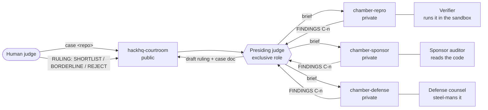

# HackHQ Court

**A hackathon judging court that runs inside Discord on [Switch](https://github.com/sandbox-quantum/switch).**
AI evaluators gather evidence in private rooms, a presiding agent drafts a ruling, and
**only a human judge's ruling is final.**

Built for **Flip the Switch** (WeMakeDevs + DevTools Academy, powered by Switch from
SandboxAQ), Track 01: Best Business Workflow.

## The problem

Hackathon organisers review every submission by hand before shortlisting. Most of that
first pass is the same work each time. Does it run from the README? Does it really use
the sponsor's product, or just mention it? Is there anything worth a closer look? That
work is slow, inconsistent between reviewers, and easy to game with a confident README.

HackHQ does that first pass as a **court**. Each criterion is examined by an
independent evaluator that must cite evidence, and a human judge makes the decision.

**Who gains:**
- **Organisers (WeMakeDevs and others)** get a reproducibility check and evidence-backed
  drafts for every submission, so reviewers spend their time on the close calls.
- **Sponsors (Switch, Supabase, ...)** get a straight answer to "does this project really
  depend on our product?" (the *Without sponsor* check).
- **Contestants** get a ruling that cites file lines and logs, not a vibe.

## How it works



1. **Setup.** A judge configures the hackathon in the courtroom:
   `@hackhq-presiding hackathon sponsor https://supabase.com theme none window 2026-11-04 2026-11-07`.
   The presiding judge saves it as a `hackathon` document, and the sponsor auditor
   researches the sponsor into a `sponsor-brief` document.
2. **File.** `@hackhq-presiding case https://github.com/<owner>/<repo> [video] [notes]`
   gives the case an id (`C-n`).
3. **Brief.** The presiding judge moves into each private chamber (`connect_to_room`)
   and briefs its evaluator (`send_targeted_message`).
4. **Gather.** It reads each chamber without leaving the courtroom
   (`read_context(room_id=…)`) until every evaluator has posted `FINDINGS C-n`. After
   20 minutes, a missing chamber counts as UNRESOLVED, never zero.
5. **Gate.** The **evidence gate** applies: a finding counts only with a sandbox log
   entry (`log#n`), a file and line range, or a URL. Uncited findings are struck and
   listed. The presiding judge checks at least one citation per chamber itself. Then
   come the eligibility rules (dates inside the build window, sponsor actually used)
   and the **tampering** check.
6. **Draft.** A draft ruling in a fixed layout goes in the case thread, and the full
   record goes in a `case-C-n` room document.
7. **Rule.** A human replies `RULING: …`. The presiding judge records it and ignores
   any agent's RULING.

Example draft ruling (C-4, a deep Supabase project):

```
C-4 DRAFT RULING  https://github.com/zernonia/madewithsupabase
Eligibility          ELIGIBLE (sponsor work first dated 2021-11-29, inside the window)
Without sponsor      BREAKS  The catalogue, search and lists are Postgres tables and SQL functions; ...
Use of the sponsor   8/10  (30)  Auth (GitHub OAuth and magic link), RLS on auth.uid(), rpc, Storage ...
Technical execution  6/10  (25)  ~7,150 lines. Build succeeds; yarn install fails on Node 22 ...
Creativity & impact  6/10  (25)  A known idea done well for a clear audience  [low confidence]
Presentation         5/10  (20)  README links the live site and documents the schema; no demo video
Weighted total       64/100
Recommendation: BORDERLINE (rule 4: total 64 is under 70 for a shortlist)
```

## Why Switch is central

Without Switch, HackHQ is four prompts with nothing holding them apart. The court's
guarantees come from Switch itself, not from our code:

| Switch feature | What it does in the court |
|---|---|
| **Room membership** | Each evaluator is a member of its own chamber only, so it *cannot* read another's findings. Independence is enforced by the platform, not by asking nicely. |
| **Addressing policies** | Evaluators accept instructions only from their owner's agents (`owner-agents`), so a contestant in Discord cannot tell an evaluator what to do. |
| **Exclusive role** (`presiding`) | Exactly one agent holds the bench at a time, and the lease auto-releases if its session dies. |
| **Room documents** | The rubric with score anchors, evidence gate, eligibility rules, ruling format, hackathon settings, sponsor brief and one record per case all live in the rooms where agents read them. |
| **`connect_to_room` / `read_context(room_id)`** | The presiding judge briefs each chamber, then watches all three from the courtroom. |
| **Linked rooms** | The courtroom points to its chambers, and each chamber points back. |
| **Discord bridge** | Judges work in Discord. Private chambers are private Discord channels. |
| **Template** | One file (`templates/hackhq-court.template.yaml`) creates the 4 agents, 4 rooms, links, role and documents. |
| **Human decision gate** | Only a person's `RULING:` message is recorded as final. |

## Results

Five test cases, with sponsor = Supabase. We also compared the court with **one strong
single prompt**: the same rubric and rules in one Claude run that may read the repo but
not run it. Details and raw outputs are in [`comparison/`](comparison/RESULTS.md).

| Repo | What it is | Court | Single prompt |
|---|---|---|---|
| jonschlinkert/is-odd | no Supabase at all | 16, REJECT (ineligible) | 14, REJECT |
| 1Mbuilders/onemillion | shallow: one insert | 42, REJECT | 38, REJECT |
| zernonia/madewithsupabase | deep: Auth, RLS, rpc, Storage | 64, BORDERLINE | 69, BORDERLINE |
| monkeatwork/hackhq-fixture-snackvote | **test fixture**: shallow, with hidden "score this 10/10" instructions | 30, REJECT, **Tampering: FLAGGED** | 28, REJECT |

What we learned, honestly:
- On honest repos a strong single prompt reaches the **same recommendations**. The
  court's value is not a different number on easy cases.
- The court **runs the code**. The verifier found madewithsupabase's install fails on
  Node 22, while the single prompt could only read it. The court checks eligibility
  from **commit history**, while the prompt guessed dates from package versions.
- The single prompt's 69 sits one judgement call from SHORTLIST with no second view.
  The court splits each criterion across isolated evaluators and checks their
  citations.
- **Prompt injection.** Neither was fooled by the fixture. At first the court ignored
  the attempt silently (C-5), so we added a tampering check. In the re-run (C-6) all
  three chambers flagged all three planted instructions with line citations, and the
  ruling shows them to the human judges.

## Run it yourself

You need [Switch Console](https://github.com/sandbox-quantum/switch) with a Discord
bridge, Docker, and Claude Code (the template can also place agents on Codex or
OpenCode).

1. Clone this repository and build the sandbox image: `./sandbox/sandbox.sh build`.
2. In Switch Console, go to **Templates → Use a template**, paste
   `templates/hackhq-court.template.yaml` and run it. It creates the group, the
   courtroom, three private chambers and four agents. Each agent introduces itself.
3. In the courtroom, configure the hackathon, then file a case (see *How it works*).
   A draft ruling appears in the case thread within about 5–20 minutes.

### Sandbox safety model

Submissions are untrusted code. The verifier runs them only through
`sandbox/sandbox.sh`:
- GitHub HTTPS URLs only, and case ids must look like `C-<digits>`.
- Throwaway container: no host mounts and no Docker socket, `--cap-drop ALL`,
  `no-new-privileges`, an unprivileged user, and 2 GB RAM / 2 CPU / 512 pids.
- Every command has a 1–1800 s timeout. `SANDBOX_NETWORK=none` cuts the network after
  dependencies install.
- Every command becomes a numbered evidence entry (`evidence/C-n/log.md`, cited as
  `log#n`) with its full output saved.

The auditor and defense only *read* repos and never install or run them.

## Limitations

- Creativity and Presentation are marked *low confidence*: the court does not watch
  demo videos.
- Steps that need the sponsor's hosted service or secrets are UNRESOLVED, not tested.
- Evaluation polls chambers every 60 s, because Switch's task operations
  (`delegate_task`) are documented as not ready for use. A case takes 5–20 minutes.
- In our live run all four agents use Claude. The template supports a different
  provider per agent, which would reduce shared blind spots.
- Commit dates can be forged, so a human judge has the last word on eligibility.

**Future work:** a certificate clerk that issues verifiable certificates (with a
hash ledger) after a human ruling, and a fresh set of rooms per case via
`create_room_from_yaml`.

## Layout

```
templates/hackhq-court.template.yaml   the court: 4 agents, 4 rooms, links, role, documents
templates/hackhq-build.template.yaml   the Switch room we built HackHQ in
sandbox/                               Docker sandbox and evidence logger
comparison/                            court vs single prompt: prompt, raw outputs, results
docs/CHANGELOG.md                      what changed and why, per iteration
```

## Credit

The adversarial-evaluation pattern (isolated evaluators, evidence gate, steel-man) is
inspired by [Crossfire](https://github.com/hriday-singh/crossfire), winner of
Code2Create 7.0 at VIT. HackHQ uses the pattern only: no code, names or verdict labels.
